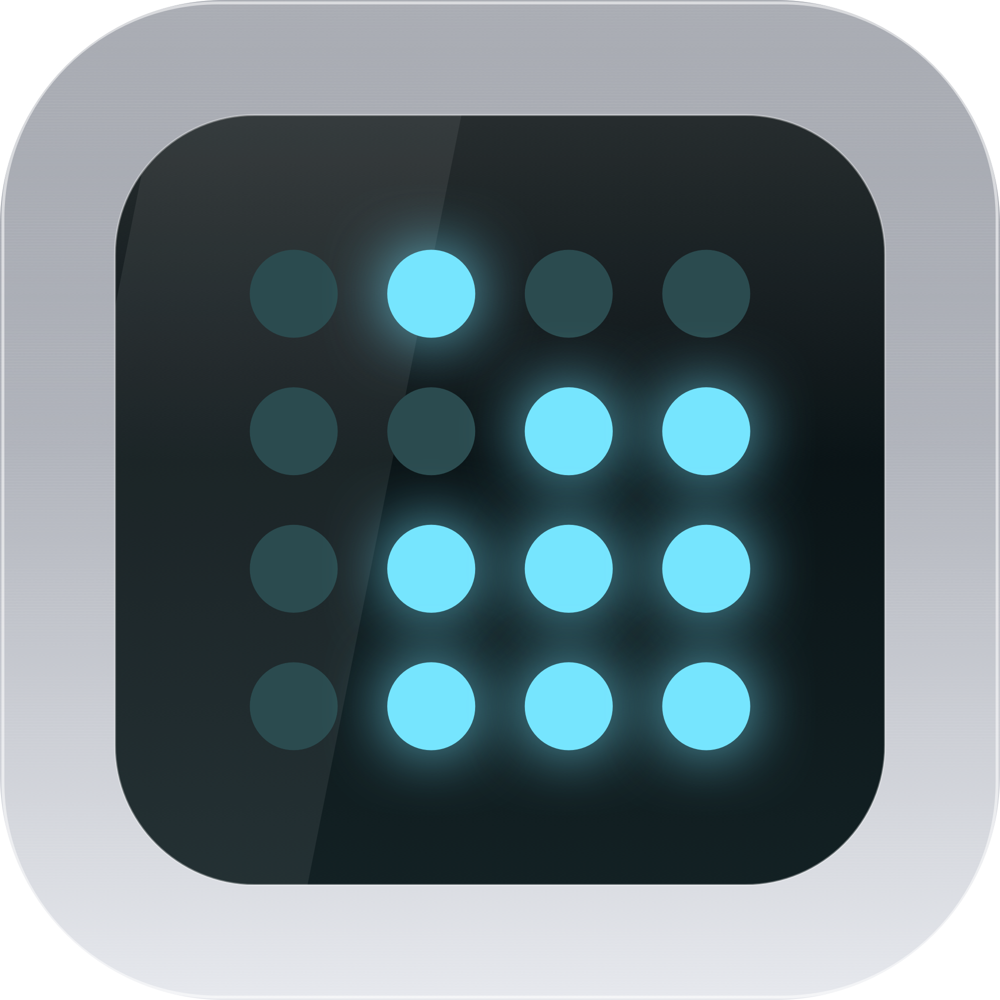

# 0B77

*Bitstream, bridged.*

Menu-bar macOS app (name from the AC-3 sync word `0x0B77`, repo
`Maryushi3/0b77-ac3-bridge`). Captures 6-channel
audio from a virtual input device, encodes it to AC-3, wraps it in IEC 61937
(S/PDIF passthrough) and plays the result as 16-bit / 48 kHz on a chosen stereo
pair of an output device.

The icon is the sync word itself — `0000 1011 0111 0111` as a 4×4 grid of EL
dots, one hex digit per column, themed after the Logitech Z5500 control pod
that started this project.
The menu-bar item shows the same grid: dim when idle, lit cyan while streaming.

Concrete setup it was built for: BlackHole 16ch (5.1 on channels 1–6) as the
movie-audio source, Focusrite Scarlett 18i20 as output, channels 9–10 wired to
its S/PDIF out in Focusrite Control, channels 1–2 left alone for regular
speakers and system sounds.

Polish + English UI (header picker, follows the system locale by default).

## Requirements

- macOS 14+, Apple Silicon
- [BlackHole 16ch](https://github.com/ExistentialAudio/BlackHole) —
  `brew install blackhole-16ch`
- ffmpeg — `brew install ffmpeg` (runtime dependency, **not** bundled; see below)
- Microphone permission for 0B77 (System Settings → Privacy & Security →
  Microphone). macOS gates *all* audio capture behind it, including virtual
  devices like BlackHole. Without it the input is silent — the app requests it
  on first Start.

Audio MIDI Setup (do once):

- BlackHole 16ch: 48000 Hz, speakers configured as 5.1 (L R C LFE Ls Rs on
  channels 1–6 — this is most likely just the default 5.1 configuration).
  Set it as the system/movie-player output.
- Scarlett (or your DAC): 48000 Hz. System volume 100%.

## Why BlackHole

Something has to present the movie player's 5.1 as six capturable channels,
and on macOS that means a virtual audio device. The alternative — writing our
own — is an AudioServerPlugIn (deprecated) or a DriverKit system extension
(entitlements, user approvals, reboots, a project of its own). BlackHole is
the maintained, standard answer; depending on it keeps this project an app
instead of a driver project.

## Why ffmpeg from Homebrew (not bundled / not linked)

- A bundled `ffmpeg` binary looks self-contained until you check
  `otool -L`: the Homebrew build is a ~400 KB stub over ~7 Cellar dylibs.
  Shipping it means re-homing the whole dylib closure (`dylibbundler` +
  `@rpath` surgery) on every ffmpeg update, inside an unsigned bundle.
- Static-linking `libavcodec` is the "real" fix (no subprocess, no pipes,
  ~5–15 ms less jitter) but buys a custom minimal-ffmpeg build, C-API churn,
  and LGPL static-link obligations — for an app with three users.
- So: `brew install ffmpeg`, the app finds it at runtime
  (`/opt/homebrew/bin` → `/usr/local/bin` → `PATH`) and fails fast with the
  brew hint if it's missing. Revisit static linking only if pipe latency ever
  shows up in measurements.

## Build & run

```sh
swift build                    # CLI sanity check
./Scripts/bundle.sh release    # builds 0B77.app, ad-hoc signed
open 0B77.app                  # Right-click → Open on first launch (unsigned)
./Scripts/make-dmg.sh 0.2.0    # GitLab-Releases-ready DMG
```

No paid Apple Developer account is used: ad-hoc signature, no notarization.
Receivers drag to /Applications and Right-click → Open once.

## Start at login

No paid signing means no `SMAppService` — the classic plist does the job:

```sh
cp -R 0B77.app /Applications/
./Scripts/install-login-item.sh              # uses /Applications/0B77.app
./Scripts/install-login-item.sh --uninstall  # remove again
```

This writes `~/Library/LaunchAgents/moe.mary.0b77.plist` and registers it for
your login session. The app launches at login but does **not** auto-start the
bridge — devices may not be up yet, and streaming onto a changed layout is
exactly what the watchdog guards against. Logs land in
`~/Library/Logs/0B77.{out,err}.log`.

## CI & releases

- Every push/PR builds on GitHub Actions (`macos-15`: SwiftPM + bundle + DMG
  smoke, DMG kept as an artifact).
- Nothing releases except strict `vX.Y.Z` tags: `git push origin v0.3.0`
  builds the DMG and publishes the GitHub Release. Branch pushes never ship.
- Release text comes from the matching `CHANGELOG.md` section (write it under
  `## [Unreleased]` as you go); a missing section falls back to generated
  notes. Local dry run: `./Scripts/bundle.sh release && ./Scripts/make-dmg.sh`.

## How it works

```
BlackHole 6ch → CoreAudio HAL IOProc → ffmpeg (s16le → ac3 → spdif)
            → HAL IOProc → output ch N/N+1, everything else silence
```

- `Sources/ZeroB77/` — SwiftPM package (no Xcode project needed):
  `ZeroB77App.swift` (MenuBarExtra UI + controller), `AudioBridge.swift`
  (HAL input/output, frame queue mirroring the prototype's prefill/drop
  logic), `EncoderProcess.swift` (ffmpeg child), `DeviceManager.swift`
  (CoreAudio enumeration), `BridgeSettings.swift` (UserDefaults),
  `L10n.swift` (all PL/EN strings, in code).
- Settings persist in UserDefaults; the original Python prototype
  (`ac3bridge.py` + `run.sh`) lives on only in git history (`prototype-tk` tag).

## Safeguards (shared-device use)

The output device stays shared with the system — no hog mode, no forced
sample-rate/format changes (only warnings to fix 48 kHz in Audio MIDI Setup).

- Start blocked when input == output, or the pair exceeds the channel count.
- Channels 1–2 (speakers) need a two-step confirm; encoded AC-3 there is
  full-scale noise.
- Silence until the first full AC-3 frame is buffered; zero-fill on underrun.
- Watchdog stops the bridge on device replug or sample-rate flip.
- UI locks device/channel/bitrate pickers while running; buffer stays
  live-tunable. Quitting always stops HAL + the ffmpeg child.

Guarding against *something else* playing on 9–10 is the operator's job.

## Status / backlog

Working: menubar app, streaming verified on-device (receiver locks, sound ok).
Ideas parked: latency instrumentation vs the ~100 ms Python baseline,
static `libavcodec` link, Windows port (separate GUI, far future).
